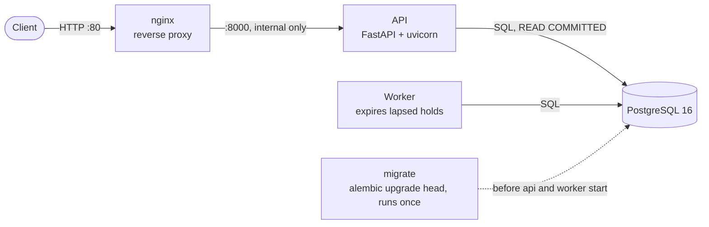
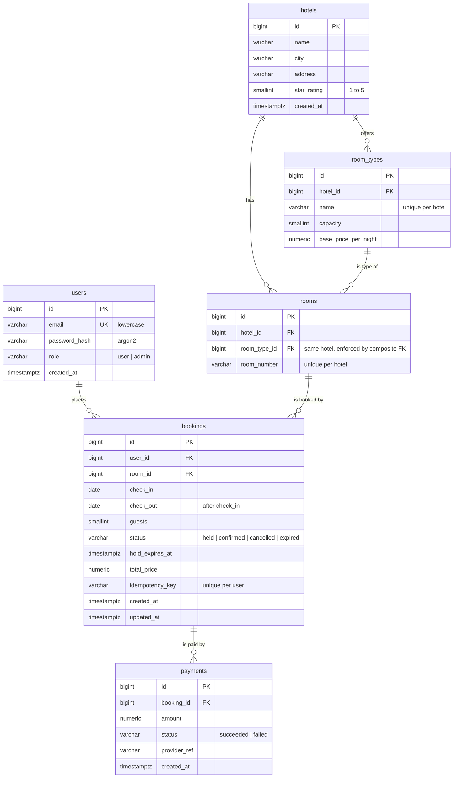

# Hotel Booking API

[](https://github.com/mansiattrii/Hotel-Room-Booking-System/actions/workflows/ci.yml)

A hotel booking backend built around one problem: **preventing double booking when many
users try to book the same room for overlapping dates at the same time.** Users search
hotels by city, check availability, place a temporary hold on a room, confirm it with a
mock payment, and cancel. Admins manage hotels, room types and rooms.

FastAPI · SQLAlchemy 2.0 · PostgreSQL 16 · Alembic · Docker · nginx · GitHub Actions

**Highlights**

- Double booking is impossible at the database level: a PostgreSQL **exclusion
  constraint** over `(room_id, daterange(check_in, check_out, '[)'))` for active bookings.
- Three strategies (naive, pessimistic lock, constraint) compared under **100 concurrent
  requests**: naive double-booked in 2 of 5 runs; the others never did.
- Indexes chosen from `EXPLAIN ANALYZE` and measured on **200,000 bookings**.
- Holds that expire, idempotent booking creation, JWT auth with roles.
- Full Docker stack (nginx, API, worker, PostgreSQL), CI on every push, and a step-by-step
  AWS deployment guide ([deploy/DEPLOY.md](deploy/DEPLOY.md)).

Design decisions, trade-offs and the bugs found along the way are written up in
[NOTES.md](NOTES.md).

## Architecture



- **nginx** is the only public entry point. The API port isn't published on the host.
- **API:** routers handle HTTP only; business logic lives in `app/services/`. Each request
  gets one database session; every booking operation is one explicit transaction.
- **Worker:** marks lapsed holds as `expired` every 30 seconds (configurable). Correctness
  doesn't depend on it: the booking path expires stale holds for the room itself, and the
  availability query ignores lapsed holds.
- **migrate:** applies migrations and exits; the API and worker wait for it to succeed.
- All configuration comes from environment variables (`.env.example` lists them).

## Schema



Key constraints:

- **No overlapping active bookings:** `EXCLUDE USING gist (room_id WITH =,
  daterange(check_in, check_out, '[)') WITH &&) WHERE (status IN ('held', 'confirmed'))`.
  The half-open range `[)` lets one guest check out on the day the next checks in.
- **At most one successful payment per booking:** a partial unique index on
  `payments (booking_id) WHERE status = 'succeeded'`. Failed attempts don't block a retry.
- `CHECK (check_out > check_in)`, prices as `NUMERIC(10,2)`, `UNIQUE (user_id,
  idempotency_key)`.

Migrations are hand-written: `0001` schema, `0002` payment attempts, `0003` query indexes.

## API summary

All endpoints are under `/api/v1`. Errors always have the shape
`{"error": {"code": "...", "message": "..."}}`. Interactive docs at `/docs`.

| Method | Path | Auth | Purpose |
|---|---|---|---|
| GET | `/health` | none | Database connectivity: 200 or 503 |
| POST | `/auth/register` | none | Create a user (201) |
| POST | `/auth/login` | none | JWT access token |
| GET | `/hotels?city=&page=&page_size=` | none | Paginated hotel list |
| GET | `/hotels/{id}` | none | Hotel with its room types |
| GET | `/hotels/{id}/availability?check_in=&check_out=&guests=` | none | Free rooms of one hotel, grouped by room type, with the stay's total price |
| GET | `/availability?city=&check_in=&check_out=&guests=` | none | Every hotel in a city with a suitable free room |
| POST | `/bookings` | user | Hold a room; `Idempotency-Key` header required (201; 409 if taken) |
| GET | `/bookings/me` | user | Your bookings, paginated |
| GET | `/bookings/{id}` | owner or admin | One booking |
| POST | `/bookings/{id}/confirm` | owner or admin | Mock payment; `tok_declined` gives 402; expired hold gives 409 |
| POST | `/bookings/{id}/cancel` | owner or admin | Cancel |
| POST | `/admin/hotels` | admin | Create a hotel |
| POST | `/admin/hotels/{id}/room-types` | admin | Create a room type |
| POST | `/admin/hotels/{id}/rooms` | admin | Create a room |

Status codes: 201 created, 401 missing or invalid token, 403 not allowed, 404 not found,
409 conflict, 422 validation error (including past dates, `check_out <= check_in`, stays
over `MAX_STAY_NIGHTS`, and more guests than the room holds).

## Results

From real runs on one machine (Windows 11, Docker Desktop, 16 logical cores, PostgreSQL 16
in Docker). Full tables, raw CSVs and query plans are in [results/](results/).

**Concurrency: 100 users book the same room for the same nights at the same instant**,
5 runs per scenario ([results/concurrency.md](results/concurrency.md)):

| Scenario | Bookings created per run | Runs that double-booked |
|---|---|---|
| naive check-then-insert, constraint dropped | 1 to 3 | **2 of 5** |
| naive, with the constraint | 1 | 0 of 5 |
| pessimistic `SELECT ... FOR UPDATE`, constraint dropped | 1 | 0 of 5 |
| constraint (production default) | 1 | 0 of 5 |

Speed differences between the strategies were within run-to-run noise (medians 2.12 to
2.33 s for all 100 requests).

**Search latency on 200,000 bookings**, 100 runs per query, client-side milliseconds
([results/search_benchmark.md](results/search_benchmark.md)):

| Query | No index (p50 / p95) | B-tree on `room_id` (p50 / p95) | Production (p50 / p95) |
|---|---|---|---|
| City search | 6600.13 / 35370.39 | 7.58 / 13.88 | 6.62 / 11.56 |
| Hotel search | 47.39 / 89.79 | 4.07 / 5.21 | 3.86 / 4.71 |
| Worker expiry sweep | 22.11 / 24.85 | 20.65 / 24.92 | 2.26 / 2.71 |

The GiST index behind the exclusion constraint searches about as fast as a plain B-tree.
It's justified by the constraint, which search then reuses, not by speed. The partial index
on held bookings is what speeds up the worker.

## Limitations

- **One API container.** Deploying a new version means a short outage; zero-downtime
  deploys need at least two replicas and rolling restarts. After the API container is
  recreated, nginx can keep using its old address for up to 10 seconds.
- **Payments are mocked.** A real provider shouldn't be called while a row lock is held;
  it would need a pending state and reconciliation (see NOTES.md).
- **Auth is minimal:** access tokens only, no refresh tokens or revocation, one shared
  HS256 secret. No rate limiting, including on login.
- **Pagination is offset-based**, which gets slower on deep pages.
- **The exclusion constraint is PostgreSQL-specific**, and on PostgreSQL 16 it rules out
  table partitioning for bookings (NOTES.md, Milestone 6).
- **Experiment numbers come from one laptop** with one API process. They compare
  strategies and index states with each other; they aren't capacity figures for a server.
- **HTTPS is optional** and wasn't tested end to end (it needs a domain).
- Seeded demo users share the password `password123` by design.

## Local setup (Windows PowerShell)

```powershell
py -3.11 -m venv .venv
.\.venv\Scripts\Activate.ps1
python -m pip install -r requirements-dev.txt

Copy-Item .env.example .env        # then edit the dummy values

docker compose up -d db
python -m alembic upgrade head
python -m uvicorn app.main:app --reload
```

Health check: <http://localhost:8000/api/v1/health>. Interactive API docs: <http://localhost:8000/docs>

## Full stack with Docker

```powershell
Copy-Item .env.example .env        # if not done already; edit the dummy values
docker compose up -d --build --wait
docker compose ps
```

| Service | What it runs |
|---|---|
| `db` | PostgreSQL 16, named volume, healthcheck; published on `127.0.0.1` only |
| `migrate` | `alembic upgrade head` once, then exits; `api` and `worker` wait for it to succeed |
| `api` | uvicorn on port 8000 inside the network (not published) |
| `worker` | `python -m app.worker` |
| `nginx` | reverse proxy, the only public entry point: port `HTTP_PORT` (default 80) |

Health check through nginx: <http://localhost/api/v1/health>. API docs: <http://localhost/docs>

Run the seed and admin scripts inside the stack:

```powershell
docker compose run --rm api python -m scripts.seed --hotels 20 --rooms 1000 --bookings 10000 --users 500
docker compose run --rm api python -m scripts.create_admin --email admin@example.com
```

Logs (JSON lines) and shutdown:

```powershell
docker compose logs -f api worker
docker compose down          # keeps the database volume
docker compose down -v       # also deletes the database volume
```

`api`, `worker` and `migrate` use one image (`Dockerfile`: multi-stage, runs as a non-root
user). Inside the stack they reach the database at `db:5432`; `docker-compose.yml` builds that
`DATABASE_URL` from the `POSTGRES_*` values in `.env`, so the password must be URL-safe.

## Data and admin account

```powershell
python -m scripts.seed                    # 200 hotels, 10,000 rooms, 200,000 bookings
python -m scripts.seed --reset            # wipe everything (including admins) and reseed
python -m scripts.seed --hotels 20 --rooms 1000 --bookings 10000 --users 500   # smaller

python -m scripts.create_admin --email admin@example.com   # prompts for a password
```

Seeded users are `user1@example.com` … `userN@example.com` with the development password
`password123`.

## Worker

Expires lapsed holds in the background (correctness doesn't depend on it; see NOTES.md):

```powershell
python -m app.worker
```

## Booking flow

```text
GET  /api/v1/availability?city=Goa&check_in=...&check_out=...&guests=2
GET  /api/v1/hotels/{id}/availability?check_in=...&check_out=...&guests=2
POST /api/v1/bookings                    (Idempotency-Key header required) -> held
POST /api/v1/bookings/{id}/confirm       {"payment_token": "tok_visa"}     -> confirmed
                                         ("tok_declined" simulates a declined card: 402)
POST /api/v1/bookings/{id}/cancel
```

`BOOKING_STRATEGY` selects how double booking is prevented: `constraint` (default),
`pessimistic`, or `naive` (demonstration only; it double-books under concurrency).

## Experiments

Both scripts run only against `hotel_booking_test` (they truncate it, and drop the exclusion
constraint while they run) and restore the production schema when they finish. Don't run
them at the same time as the tests.

```powershell
python -m scripts.concurrency_test       # 100 simultaneous bookings of one room, per strategy
python -m scripts.benchmark_search       # search latency and EXPLAIN plans, by index state
```

Output goes to `results/`: `concurrency.md`/`.csv`, `search_benchmark.md`/`.csv`, and the
query plans in `results/explain/`.

## Tests and lint

```powershell
python -m pytest
python -m ruff check .
python -m ruff format --check .
```

Tests run against the `hotel_booking_test` database, which the db container creates on first
start. They rebuild the schema from the migrations, so they never touch development data.

## CI

`.github/workflows/ci.yml` runs on every push and pull request, in three parallel jobs:

- **lint:** `ruff check` and `ruff format --check`.
- **test:** `pytest` against a PostgreSQL 16 service container.
- **docker:** builds the image, checks it runs as a non-root user, and imports the app,
  worker and seed script inside it.

Render the migration SQL without a database:

```powershell
python -m alembic upgrade head --sql
```
